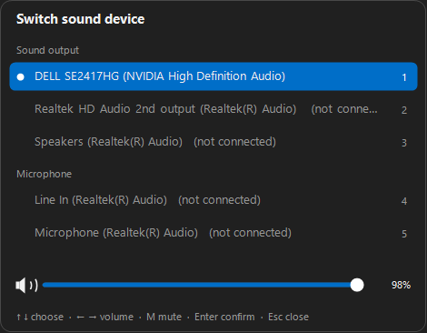
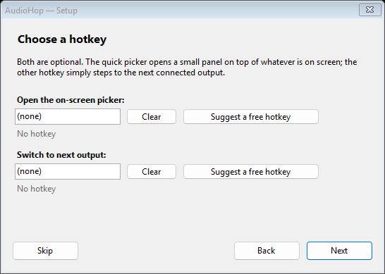
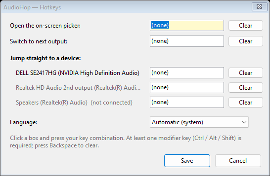

# AudioHop

Switch the Windows sound device without digging through Settings.

AudioHop sits in the system tray. Press a hotkey and a small picker appears on
top of whatever is on screen — pick an output with the arrow keys, the mouse or
a number key, set its volume, done. No installer service, no background bloat:
one 260 KB executable, no dependencies beyond the .NET Framework that Windows
already ships.

*[Türkçe benioku](README.tr.md)*



## What it does

- **On-screen picker** over everything, opened by a hotkey — like the Game Bar,
  but only for sound devices.
- **Volume slider** for the highlighted device, with mute. Works per device, so
  you can set the headset's level before switching to it.
- **Tray menu** listing every playback and recording device, with the active one
  ticked.
- **Hotkeys you choose**: open the picker, step to the next output, or jump
  straight to one specific device. Nothing is pre-assigned — the setup wizard
  suggests combinations that are provably free.
- **15 languages**, picked from your Windows language automatically, and you can
  add your own.
- Switches all three audio roles at once (Console, Multimedia, Communications),
  so games, media players and call apps follow together.

## Install

### Terminal (recommended)

```powershell
irm https://raw.githubusercontent.com/chnozmn-pixel/AudioHop/main/install.ps1 | iex
```

With options — install and start with Windows:

```powershell
& ([scriptblock]::Create((irm https://raw.githubusercontent.com/chnozmn-pixel/AudioHop/main/install.ps1))) -AutoStart
```

It downloads the latest release into `%LOCALAPPDATA%\Programs\AudioHop`, adds a
Start Menu entry and launches the app. No admin rights needed.

### Scoop

```powershell
scoop install https://raw.githubusercontent.com/chnozmn-pixel/AudioHop/main/packaging/scoop/audiohop.json
```

### winget

```powershell
winget install chnozmn-pixel.AudioHop
```

### By hand

Download `AudioHop.exe` from the [latest release](https://github.com/chnozmn-pixel/AudioHop/releases/latest)
and run it. It is portable — it writes nothing outside
`%APPDATA%\AudioHop`, so you can keep it on a USB stick.

### Uninstall

```powershell
irm https://raw.githubusercontent.com/chnozmn-pixel/AudioHop/main/uninstall.ps1 | iex
```

Or delete the folder and remove the Start Menu shortcut — that is all there is.

## First run

A three-step wizard opens the first time: language, hotkeys, and optional
per-device hotkeys plus "start with Windows". You can skip it and set
everything later from the tray menu (**Setup wizard…** / **Hotkeys…**).



**Suggest a free hotkey** does not guess: it asks Windows to reserve each
candidate in turn and offers the first one nothing else holds. The status line
underneath tells you, live, whether the combination you typed is free.

## Using the picker

| Key | Action |
| --- | --- |
| `↑` `↓` | Move through the devices |
| `1`–`9` | Jump straight to that device |
| `←` `→` | Volume (hold `Shift` for 1% steps) |
| `M` | Mute / unmute |
| `Enter` | Switch to the highlighted device |
| `Esc` | Close |

The mouse works too: click a row, drag the slider, click the speaker to mute,
scroll the wheel (over the slider it changes volume, elsewhere it walks the
list). Clicking outside closes the picker, and pressing the hotkey again
toggles it.

## Settings



Settings live in `%APPDATA%\AudioHop\settings.ini` — a plain text file:

```ini
language=auto
overlay=Ctrl+Alt+F9
cycle=Ctrl+Alt+F10
device={0.0.0.00000000}.{223d7dce-...}|Ctrl+Alt+1
```

## Languages

English, Türkçe, Deutsch, Français, Español, Italiano, Português, Nederlands,
Polski, Русский, Українська, 中文（简体）, 日本語, 한국어, العربية (right-to-left
layout included).

To add or correct one, drop a UTF-8 file named `<code>.lang` into
`%APPDATA%\AudioHop\lang\`:

```ini
language.name=Svenska
menu.exit=Avsluta
overlay.title=Byt ljudenhet
```

Keys you leave out fall back to English, and the file also overrides built-in
text — so you can fix a wording you dislike without rebuilding. The full key
list is in [`Languages.cs`](Languages.cs).

## Building

No SDK required: it builds with the C# compiler that ships with Windows.

```bat
build.cmd
```

That runs `csc.exe` from `%WINDIR%\Microsoft.NET\Framework64\v4.0.30319` over
[`AudioHop.cs`](AudioHop.cs) and [`Languages.cs`](Languages.cs) and produces
`AudioHop.exe`. Target framework: .NET Framework 4.0+, WinForms, x64.

The icons are built from the SVG artwork in [`assets/`](assets). After changing
it, run `tools\make-icon.ps1` to regenerate `assets\AudioHop.ico` (the
executable and window icon) and `assets\tray.ico` (the tray, where only the
switch stays readable at 16 px). `build.cmd` consumes the finished `.ico` files.

Set `AUDIOHOP_LOG=1` before launching to get a trace in
`%TEMP%\audiohop.log` (hotkey registrations, hotkey presses, device switches).

## How it works

Device enumeration uses the Core Audio `IMMDeviceEnumerator`; switching uses
`IPolicyConfig`, the same undocumented interface the Windows sound panel itself
uses — no admin rights, no drivers, no third-party libraries. Volume goes
through `IAudioEndpointVolume`. Hotkeys are plain `RegisterHotKey`.

## Known limits

- **Exclusive-fullscreen games.** The picker is a normal top-most window, so it
  draws over borderless-fullscreen and windowed games, but Windows will not put
  any ordinary window above an exclusive-fullscreen DirectX surface. Per-device
  hotkeys still switch the sound there, without showing the panel.
- **Unplugged devices.** Windows accepts a switch to a disconnected device and
  then keeps playing through the old one. AudioHop checks what actually
  happened and tells you instead of claiming success.
- Windows 10 and 11, x64.

## Roadmap

- Equalizer.

## License

[MIT](LICENSE)
