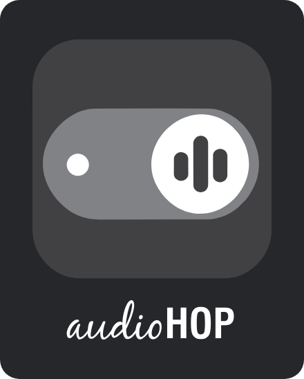
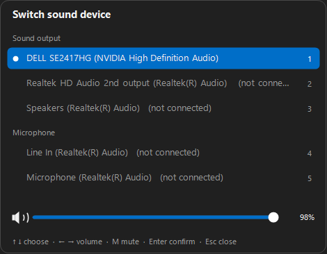
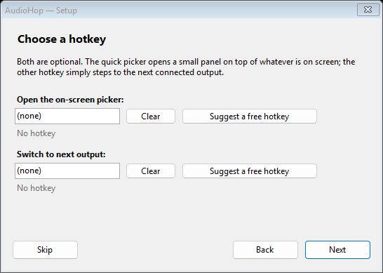
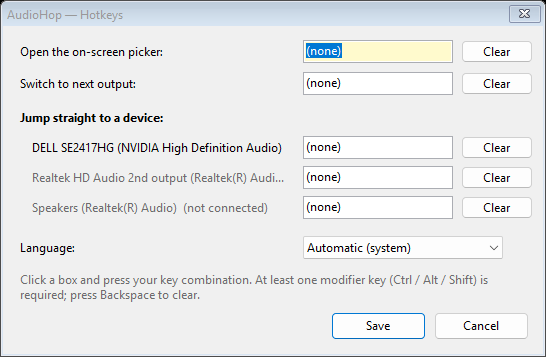

# AudioHop

Windows'ta ses cihazını Ayarlar'ı karıştırmadan değiştir.

AudioHop sistem tepsisinde durur. Bir kısayola basarsın, ekranda ne varsa onun
üstünde küçük bir seçici açılır — ok tuşları, fare ya da rakam tuşuyla çıkışı
seç, sesini ayarla, bitti. Arka planda servis yok, şişkinlik yok: 260 KB'lik tek
bir çalıştırılabilir dosya, Windows'ta zaten bulunan .NET Framework dışında
hiçbir bağımlılığı yok.

*[English readme](README.md)*



## Ne yapar

- Her şeyin üstünde açılan **hızlı seçici** — Game Bar gibi, ama yalnızca ses
  cihazları için.
- Seçili cihaz için **ses çubuğu** ve sessize alma. Cihaz bazında çalışır; yani
  kulaklığa geçmeden önce sesini ayarlayabilirsin.
- Tüm çıkış ve giriş cihazlarını listeleyen, kullanımdakini işaretleyen **tepsi
  menüsü**.
- **Senin seçtiğin kısayollar**: seçiciyi aç, sıradaki çıkışa geç ya da belirli
  bir cihaza doğrudan atla. Hiçbiri önceden atanmış gelmez — kurulum sihirbazı
  gerçekten boş olduğunu doğruladığı kombinasyonları önerir.
- Windows diline göre otomatik seçilen **15 dil**; kendi dilini de ekleyebilirsin.
- Üç ses rolünü birden değiştirir (Konsol, Multimedya, İletişim); oyun, oynatıcı
  ve görüşme uygulamaları birlikte takip eder.

## Kurulum

### Terminal (önerilen)

```powershell
irm https://raw.githubusercontent.com/chnozmn-pixel/AudioHop/main/install.ps1 | iex
```

Seçeneklerle — kur ve Windows ile başlat:

```powershell
& ([scriptblock]::Create((irm https://raw.githubusercontent.com/chnozmn-pixel/AudioHop/main/install.ps1))) -AutoStart
```

Son sürümü `%LOCALAPPDATA%\Programs\AudioHop` içine indirir, Başlat menüsüne
kısayol ekler ve uygulamayı başlatır. Yönetici yetkisi gerekmez.

### Scoop

```powershell
scoop install https://raw.githubusercontent.com/chnozmn-pixel/AudioHop/main/packaging/scoop/audiohop.json
```

### winget

```powershell
winget install chnozmn-pixel.AudioHop
```

### Elle

[Son sürümden](https://github.com/chnozmn-pixel/AudioHop/releases/latest)
`AudioHop.exe` dosyasını indir ve çalıştır. Taşınabilirdir —
`%APPDATA%\AudioHop` dışına hiçbir şey yazmaz, USB bellekte de taşıyabilirsin.

### Kaldırma

```powershell
irm https://raw.githubusercontent.com/chnozmn-pixel/AudioHop/main/uninstall.ps1 | iex
```

Ya da klasörü ve Başlat menüsü kısayolunu sil — hepsi bu kadar.

## İlk çalıştırma

İlk açılışta üç adımlı sihirbaz çıkar: dil, kısayollar, isteğe bağlı cihaz
kısayolları ve "Windows ile başlat". Atlayıp her şeyi sonradan tepsi menüsünden
de ayarlayabilirsin (**Kurulum sihirbazı…** / **Kısayol tuşları…**).



**Boştaki bir kısayol öner** düğmesi tahmin yürütmez: adayları sırayla Windows'a
kaydettirmeyi dener ve başkasının tutmadığı ilkini verir. Altındaki satır, elle
yazdığın kombinasyonun boş olup olmadığını anında söyler.

## Seçiciyi kullanmak

| Tuş | İşlev |
| --- | --- |
| `↑` `↓` | Cihazlar arasında gez |
| `1`–`9` | Doğrudan o cihazı seç |
| `←` `→` | Ses seviyesi (`Shift` ile %1'lik adım) |
| `M` | Sessize al / aç |
| `Enter` | Seçili cihaza geç |
| `Esc` | Kapat |

Fare de çalışır: satıra tıkla, çubuğu sürükle, sessize almak için hoparlöre
tıkla, tekerleği çevir (çubuğun üzerindeyken ses, başka yerde liste). Dışarı
tıklayınca kapanır, kısayola tekrar basınca açılıp kapanır.

## Ayarlar



Ayarlar `%APPDATA%\AudioHop\settings.ini` içinde, düz metin olarak durur:

```ini
language=auto
overlay=Ctrl+Alt+F9
cycle=Ctrl+Alt+F10
device={0.0.0.00000000}.{223d7dce-...}|Ctrl+Alt+1
```

## Diller

English, Türkçe, Deutsch, Français, Español, Italiano, Português, Nederlands,
Polski, Русский, Українська, 中文（简体）, 日本語, 한국어, العربية (sağdan sola
düzen dahil).

Dil eklemek ya da düzeltmek için `%APPDATA%\AudioHop\lang\` klasörüne
`<kod>.lang` adında UTF-8 bir dosya koy:

```ini
language.name=Svenska
menu.exit=Avsluta
overlay.title=Byt ljudenhet
```

Yazmadığın anahtarlar İngilizceye düşer; dosya gömülü metni de ezdiği için
beğenmediğin bir ifadeyi yeniden derlemeden düzeltebilirsin. Anahtarların tam
listesi [`Languages.cs`](Languages.cs) içinde.

## Derleme

SDK gerekmez; Windows ile gelen C# derleyicisiyle derlenir.

```bat
build.cmd
```

Bu, `%WINDIR%\Microsoft.NET\Framework64\v4.0.30319` altındaki `csc.exe` ile
[`AudioHop.cs`](AudioHop.cs) ve [`Languages.cs`](Languages.cs) dosyalarını
derleyip `AudioHop.exe` üretir. Hedef: .NET Framework 4.0+, WinForms, x64.

Simgeler [`assets/`](assets) klasöründeki SVG çizimlerden üretilir. Çizimi
değiştirdiysen `tools\make-icon.ps1` ile `assets\AudioHop.ico` (exe ve pencere
simgesi) ile `assets\tray.ico` (tepsi; 16 px'te yalnızca anahtar okunaklı
kaldığı için ayrı) dosyalarını yeniden oluştur. `build.cmd` yalnızca hazır
`.ico` dosyalarını kullanır.

Başlatmadan önce `AUDIOHOP_LOG=1` ayarlarsan `%TEMP%\audiohop.log` dosyasına
iz kaydı düşer (kısayol kayıtları, basışlar, cihaz değişimleri).

## Nasıl çalışıyor

Cihazları Core Audio `IMMDeviceEnumerator` ile listeler; değiştirmek için
`IPolicyConfig` kullanır — Windows'un kendi ses panelinin kullandığı,
belgelenmemiş arayüz. Yönetici yetkisi, sürücü ya da üçüncü parti kütüphane
yok. Ses seviyesi `IAudioEndpointVolume` üzerinden, kısayollar düz
`RegisterHotKey` ile.

## Bilinen sınırlar

- **Exclusive-fullscreen oyunlar.** Seçici normal bir en-üstte penceredir;
  kenarlıksız tam ekran ve pencereli oyunların üstüne çizilir, ama Windows hiçbir
  sıradan pencereyi exclusive-fullscreen DirectX yüzeyinin üstüne koymaz. Orada
  cihaz kısayolları panel açmadan yine de ses cihazını değiştirir.
- **Bağlı olmayan cihazlar.** Windows, bağlı olmayan bir cihaza geçme isteğini
  kabul eder ama sesi eskisinden çalmaya devam eder. AudioHop gerçekte ne
  olduğunu kontrol eder ve başarılı olmuş gibi davranmaz.
- Windows 10 ve 11, x64.

## Yol haritası

- Ekolayzer.

## Lisans

[MIT](LICENSE)
